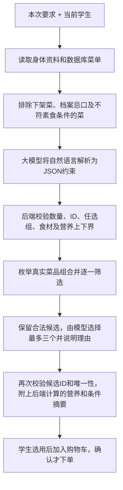

# 食堂 AI 推荐：实现、边界与验证

更新时间：2026-11-10。

## 菜品从哪里来

所有可推荐的菜品来自 SQLite 的 dishes 表。管理员维护菜名、分类、每份营养、主要食材、素食标记和是否供应。模型不能自行创造菜品ID或把数据库里没有的龙虾加入结果；选用和下单时还会检查菜品有没有下架、修改。

当前项目是课设演示，默认菜品和营养为演示数据，没有对接真实食堂的库存、收银或采购系统。因此“菜单中正在供应”是数据库里的状态，是否对应线下真实菜品需要管理员维护。本次扩展的12道测试菜只加入隔离测试库，不代表真实食堂在售。

## 一句话如何变成套餐

例如“米饭、两菜一汤、一荤一素、热量不超过850千卡”会得到主食1、配菜2、汤1、荤配菜1、允许主食为米饭ID、热量上限850的约束。后端会检查每一组候选是否同时满足，所有营养总量按数据库每份数值计算。只要有一项不符，就不能成为供模型选择的候选。

“牛肉或虾任选一个”用任选ID组表达，与“牛肉和虾都要”的全部必选ID区分；“不要鱼虾/豆制品”除模型排除ID外还做后端菜名与食材别名匹配。纯素在素食标记之外排除蛋、奶、蜂蜜。明确的营养数字用上下界校验，不能降为“尽量满足”的软偏好。

如果满足所有要求的组合只有一种或两种，如已经指定所有菜品，则只返回实际的1～2种并显示说明，不复制凑数。无合法组合时说明失败，不能自动去掉用户要求或个人忌口。仍有多个候选时最多返回三种。

## 用到的技术

- Vue 3：要求输入、等待与错误反馈、条件摘要、套餐和购物车展示。
- Java 21 / Spring Boot：身份、业务编排、输入校验、候选组合、营养计算及订单事务。
- SQLite / JDBC：读取真实数据库菜单、个人档案，持久化订单。
- OpenAI兼容聊天接口（本项目已有Qwen配置）：自然语言理解、结构化JSON输出、从合法候选中解释和选择。
- 约束筛选：数量/类别、荤素、必选/排除/任选、食材别名、营养上下界同时满足。使用有上限的组合搜索和候选优先队列，没有额外引入求解器或向量数据库。
- JUnit、Mockito、真实HTTP和隔离SQLite、Playwright、真实模型评估脚本：分别验证确定性规则、接口/事务、页面和真实模型的语义理解。

校园知识问答使用的向量RAG仍是另一条业务链路。食堂推荐主要依靠结构化菜单和约束筛选。

## 哪些可以严格检查，哪些仍有边界

已解析的数量、ID、营养数值、登记食材都能由代码检查；但自然语言到约束的翻译仍由模型完成，可能误解复杂句子。因此页面展示后端生成的“本次搭配条件”，测试用独立人工期望逐个核对结果，不用同一个模型给自己打分。

无数字的“更清淡/更好吃/高蛋白一点”属于排序偏好，不等同于有精确阈值的保证。若有硬要求，明确“蛋白质至少50克”更易核验。价格、盐克数、辣度等当前未建模数据不能凭空保证。菜单标签可能不完整，别名匹配不能证明实际配方或过敏交叉接触安全。

原有身体能量范围（估算单餐目标±25%）继续与用户上下限同时生效；例如“100千卡的米饭两菜一汤”通常无法满足。单餐支持0～1份主食、0～4道配菜、0～1份汤，至少一道，每道标准份只选一次；更多份量可在手动购物车调整。

模型返回无效JSON时，仅食堂的无业务写入调用允许重试一次，不进行无限重试或伪造推荐。超时、权限错误及业务条件冲突仍明确失败。真实模型非确定性、供应和档案会改变，有限测试不能保证任意表达永远成功。

## 复跑方法与证据

`code/frontend/tests/meal-evaluation-cases.js`保存独立期望和12道补充测试菜，`evaluate-meal-requirements.mjs`在显式指定的隔离服务上逐项核对：菜品必须等于供应菜单快照，数量、荤素、必选/任选、排除食材、营养和套餐唯一性全部满足。每个场景使用独立登录会话，最多两个并行请求；保留每一轮结果和失败，不用重试覆盖首轮记录。

运行需设置CAMPUS_REAL_TEST_URL和CAMPUS_EVALUATION_ISOLATED=1；可用CAMPUS_EVALUATION_CASES选择逗号分隔的场景ID。结果位于忽略目录code/frontend/test-results/meal-evaluation-*.json。具体实际结果在开发测试报告本次增量章节。

本次实际完成三轮共52次真实推荐请求，覆盖34种要求，34种均已逐项通过；最终重测与新增的10项连续通过。原始结果为7/12、优化后28/30、最终10/10，保留了功能失败及超时/格式错误记录。另有99项后端测试、20项浏览器测试通过。完整场景矩阵与失败原因见[开发测试报告](开发测试报告.md)末尾。
